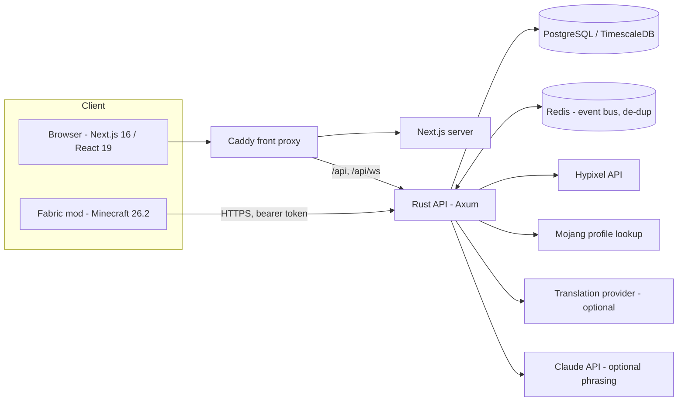

# Architecture

## Request flow: "analyse my profile"

1. `POST /api/analyze` (session cookie + `x-csrf-token`) → rate limit per IP (6/min).
2. Username → UUID (Mojang), `GET /v2/skyblock/profiles` (+ museum, garden) through
   `packages/hypixel-client` (cache, RateLimit headers, 429 back-off, circuit breaker).
3. `services/profile-analyzer` decodes inventories (base64 gzip NBT), computes levels from
   NEU XP tables, gear/accessories/pets, networth (via the pricing engine) and progression
   scores. Anything the API does not expose becomes `Known::Unknown { reason }`.
4. `services/recommendation-engine`: goal parser (JA/EN) → `GraphBuilder` (requirements from
   the Hypixel items resource, recipes from NEU, readiness heuristics flagged as such) → prune
   satisfied nodes → roadmap → providers propose `CandidateAction`s → `ScoringStrategy`
   (pluggable, play-style weights) → ranked `RecommendedAction`s with confidence and sources.
5. The response, a progress snapshot and the gzipped raw payload are stored. Re-planning
   (goal edits, advisor pages) reuses the stored payload - no further Hypixel calls.

## Market pipeline

`services/market-collector` (embedded in the API by default) polls:

| Source | Cadence | Notes |
|---|---|---|
| `/v2/skyblock/auctions` (all pages) | when `lastUpdated` changes (~60 s) | concurrency 6 |
| `/v2/skyblock/auctions_ended` | 30 s | sales history |
| `/v2/skyblock/bazaar` | 30 s | 15-minute history points |

Listings are normalised (`packages/items`: NBT and 1.21.5+ data components → fingerprint →
comparable price key), sales are de-duplicated and kept per price key (ring buffer + DB).
`services/pricing-engine` computes fair values (ask anchor, MAD outlier removal,
recency-weighted median, trimmed mean, liquidity, volatility, trend, confidence), flips
(`profit × P(sale) × confidence / (capital × time × risk)` via a `FlipScoreStrategy`),
manipulation flags, bazaar order flips with fill-time estimates, craft/forge/Kat flips and
backtests over recorded candidates. Updates are pushed to WebSocket clients through the event
bus (Redis pub/sub when configured, so every replica streams them).

## Persistence

`migrations/0001_init.sql` (users, sessions, device codes/tokens, goals, analyses, snapshots,
raw profiles, auctions, sales, bazaar snapshots, price history, flip candidates, notification
rules, push subscriptions, session stats) and `0002_timescale.sql` (hypertables + retention
when the TimescaleDB extension exists; no-op on plain PostgreSQL). Without `DATABASE_URL` an
in-memory store implements the same `Store` trait.

## Web

App Router pages are thin server components that render client views; data comes from the
API through React Query (`lib/hooks.ts`), types are generated from Rust (`packages/protocol/ts`).
`proxy.ts` sets a per-request nonce CSP. Live flips use the WebSocket and fall back to polling.

## Mod

See [mod.md](mod.md): version-independent modules + `platform/mc26_2`.
